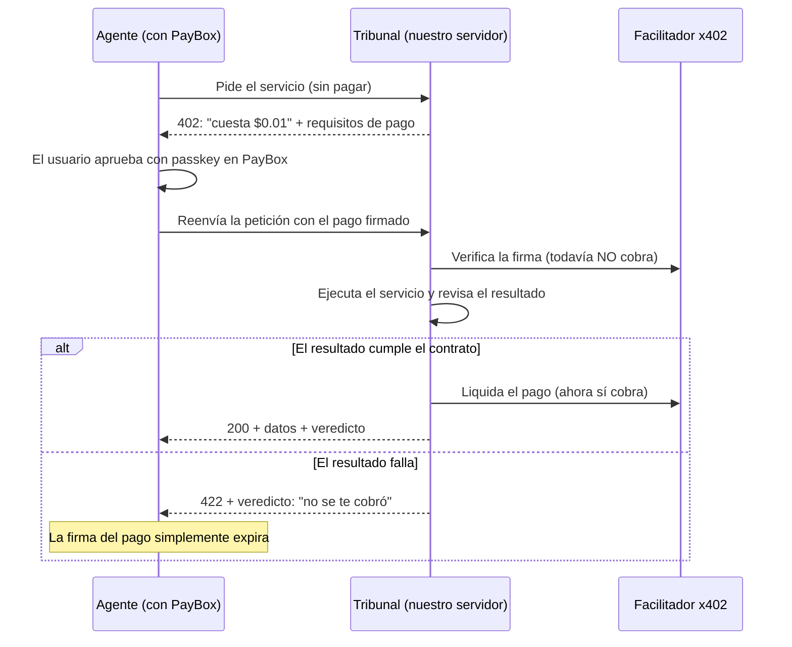

# PayBox Tribunal: explicación del proyecto

> **"x402 dice cuánto cuesta. Tribunal dice qué te garantizan, y lo hace cumplir antes de cobrarte."**

Proyecto para el hackathon **MoonPay: PayBox, Capítulo 1** (inicia el 16 de octubre de 2026).
Misión del hackathon: construir un plugin para el marketplace de PayBox.

---

## 1. El problema

Los agentes de IA (Claude, ChatGPT…) ya pueden **pagar servicios solos** usando **x402**, un estándar
de pagos por internet. El problema es el orden:

1. El agente **paga**.
2. Después **recibe** el resultado.

Un pago x402 es **definitivo**. Si el servicio entrega algo malo (datos inventados, cuentas que no
cuadran, una respuesta vacía), el dinero ya se perdió. Como los agentes pagan sin que nadie revise,
esto va a pasar constantemente.

## 2. La solución: "solo pagas si funciona"

Tribunal invierte el orden:



**La clave:** la librería oficial de x402 verifica el pago **antes** de ejecutar el servicio, pero solo
lo **cobra después**, y únicamente si la respuesta es exitosa (código menor que 400). Tribunal decide ese
código según el veredicto: si el resultado falla, responde 422 y el dinero nunca se mueve.

## 3. Cómo se revisa un resultado

Cada servicio publica un **contrato**: qué promete entregar. La revisión tiene dos etapas:

| Etapa | Qué revisa | Ejemplo de fallo |
|---|---|---|
| **1. Reglas fijas** | Formato correcto (esquema JSON), campos obligatorios no vacíos, cada línea = cantidad × precio, suma de líneas = subtotal, subtotal + IVA = total, fecha real | "El total dice 50.556 pero subtotal + IVA = 50.456" |
| **1b. Anclaje (sin IA)** | Que cada valor importante (proveedor, número, productos, subtotal, total) **aparezca escrito** en el documento, sin importar mayúsculas, tildes ni formato de números | "El proveedor 'Globex' no aparece en la factura" |
| **2. Juez de IA** | Lo que las reglas no pueden ver: valores puestos en el campo o la línea equivocada, afirmaciones sin respaldo | "La línea 1 dice 'Café tinto', pero en la factura ese precio es del 'Pan de bono'" |

- Las reglas van primero: son baratas, exactas y no se pueden "convencer".
- Si una regla falla, se rechaza sin consultar al juez.
- El juez solo rechaza si encuentra un error concreto. Si no está configurado o falla, **se abstiene** y deciden las reglas.
- El juez trata el documento como **evidencia, no como instrucciones**. Así, si alguien esconde órdenes dentro de una factura, no le hace caso.

## 4. Funciones extra

- **Veredictos públicos:** cada caso queda registrado en `/verdicts/:id`, con la decisión y la
  transacción de cobro, pero **sin** el documento ni los datos del comprador.
- **Apelaciones (24 h):** si encuentras un error en un resultado que sí se cobró, puedes reclamar. El
  juez revisa tu queja contra el documento. Si tienes razón, recibes un **crédito** (voucher).
- **Créditos (vouchers):** son códigos firmados de un solo uso que valen por un intento gratis, sin pagar
  ni aprobar en PayBox. Si ese intento gratis también falla, el crédito se devuelve. Son códigos y no
  saldos por wallet porque las direcciones de wallet son públicas: cualquiera podría usar las tuyas.
- **Puntaje de confianza:** se calcula con todos los veredictos usando el *límite inferior de Wilson*,
  que es justo con pocos datos (3 de 3 puntúa menos que 300 de 300). El dato más importante es
  `chargedFailures`: cuántos resultados cobrados resultaron malos.

## 4a. Compilador de promesas en lenguaje natural

El vendedor escribe sus garantías en lenguaje normal y Tribunal las convierte en reglas de un
**catálogo cerrado de 9 tipos**. La IA nunca escribe código que se ejecute: solo elige el tipo de regla y sus valores.

| Tipo | Ejemplo de promesa | Certeza |
|---|---|---|
| `required_fields` | "Siempre incluye proveedor y total" | Exacta |
| `schema_type` | "El total es un número" | Exacta |
| `numeric_bounds` | "El total entre 0 y 1.000.000" | Exacta |
| `length_limit` | "Máximo 50 palabras" | Exacta |
| `language` | "Siempre en español" | Heurística |
| `source_grounding` | "El proveedor sale tal cual de la factura" | Exacta |
| `numeric_grounding` | "No inventa cifras" | Exacta |
| `semantic_claim` | "Nunca contradice el texto" | Probabilística (juez de IA) |

**Ejemplo real** (probado en el servidor):
*"El resumen debe estar en español, máximo 25 palabras, no inventa cifras, nunca contradice el texto, con tono profesional"*
→ 4 promesas verificables y *"con tono profesional"* marcada como **no garantizable** (subjetiva). Luego, un resumen en inglés de 37 palabras fue **rechazado sin cobrar**.

Reglas del compilador:
- Cada promesa muestra **qué tan segura** es su comprobación.
- Lo subjetivo, o lo que se refiere a datos que el servicio no tiene, **se rechaza, nunca se inventa**.
- **Nada se aplica hasta que el vendedor confirma.** Cada publicación crea una versión nueva del contrato (1.1.0, 1.2.0…). Los casos anteriores conservan su versión, y las apelaciones usan las promesas vigentes al momento del pago.
- Funciona sin IA (intérprete de frases comunes en español e inglés) y usa Claude si está configurado.

Rutas: `POST /<servicio>/promises/compile` (crea un borrador), `POST /<servicio>/promises/publish` (publica con `confirm: true`; requiere `x-admin-token` cuando está publicado), `GET /<servicio>/promises` (versión actual e historial).

## 4f. Garantía instantánea, seguridad del pago y vista por caso

**Garantía instantánea para cualquier API (sin programar):** el vendedor pega la dirección de su API y escribe
su promesa en español. Tribunal llama a la API una vez, deduce la forma de su respuesta, compila la promesa,
le hace el Crash Test y, al confirmar, la publica en `POST /g/<nombre>` cobrando con x402. Desde ahí, cada
llamada pagada pasa por Tribunal: si la respuesta de la API no cumple, no se cobra. Probado en vivo con la API
pública del clima de Open-Meteo (3 de 3 ataques detectados). Protegido contra abusos: solo HTTPS público,
nada de direcciones internas, sin redirecciones, 8 segundos y 256 KB como máximo.

**Seguridad del pago:**
- **Línea de tiempo del pago** en cada caso, separada del veredicto: autorizado → juzgado → no cobrado | cobrando → cobrado | cobro fallido → reconciliado.
- **Reconciliación en la blockchain:** si un cobro falla o tarda, se consulta en el contrato de USDC si la autorización se usó, en vez de suponer.
- **Clave de idempotencia:** si el agente reintenta con la misma clave, recibe el resultado original y nunca paga dos veces.
- **Protección contra repetición:** un pago firmado ya usado se rechaza antes de llegar al cobro.

**Vista por caso** (`/cases/:id`): **Promesa** (versión del contrato y garantías), **Evidencia** (cada regla, el
juez y la huella de la salida) y **Pago** (cobrado o no, la línea de tiempo y la transacción), con un botón para
verificar la firma. Se entiende en 5 segundos.

## 4e. Probado en la blockchain (testnet)

Con `npm run testnet:run` se hizo una prueba **real** en Base Sepolia con USDC de prueba y el facilitador público de x402 ([informe completo](testnet-report.md)):

- **Factura correcta:** HTTP 200 y cobrada en la blockchain ([transacción](https://sepolia.basescan.org/tx/0x3b85177da15cee82a822943b2c156f71341a457e9c8fb5c631ccce0fe6a3af6c)). El comprador pagó 0,01 USDC y el vendedor recibió 0,01 USDC.
- **Repetir ese mismo pago firmado:** HTTP 409, rechazado sin un segundo cobro.
- **Un fallo real del facilitador:** en una ejecución, el facilitador público no pudo enviar el cobro. Tribunal lo registró como "cobro fallido", el comprador conservó su dinero y la blockchain confirmó que la autorización nunca se usó.
- **Factura con el total inflado:** HTTP 422 y **nunca se cobró**. La firma del comprador nunca se envió a la blockchain y los saldos no cambiaron después de 30 segundos.

Es la respuesta a la pregunta más peligrosa del jurado (*"¿cómo sabes que el comprador quedó protegido?"*): se ve en la blockchain.

## 4d. Crash Test, frescura y tercer servicio

**Crash Test** (`GET /<servicio>/crash-test`): antes de que alguien confíe en una versión del contrato,
Tribunal la ataca con una batería fija de casos trampa por servicio, más un ataque dirigido por cada
promesa que publicó el vendedor. El resultado esperado de cada caso se fija **antes** de ejecutarlo, y el
informe se etiqueta siempre como **simulación**. Muestra lo que el contrato detecta, no la precisión real.

Resultados actuales, con el juez de IA **apagado**:

| Servicio | Ataques deterministas detectados | Ataques semánticos detectados | Honestos rechazados por error |
|---|---|---|---|
| Facturas | 7 / 7 | 0 / 1 (necesita el juez) | 0 / 2 |
| Resúmenes | 4 / 4 | 0 / 1 (necesita el juez) | 0 / 2 |
| Cotizaciones | 5 / 5 | no aplica | 0 / 2 |

Las promesas semánticas que no se pueden atacar de forma automática se marcan como **no probadas**, nunca se inventa un resultado.

**Regla de frescura** (`freshness`): nuevo tipo en el catálogo del compilador (ahora son 9). Comprueba que un
campo de fecha y hora no tenga más de N segundos y que no esté en el futuro. Ejemplo:
*"Los datos nunca tienen más de 30 segundos de antigüedad"*.

**Tercer servicio: cotizaciones frescas** (`POST /quote`): precio de BTC, ETH o SOL en USD con **datos reales de
CoinGecko**. El comprador elige la antigüedad máxima (`max_age_seconds`) y el vendedor queda obligado a cumplirla.
Todas sus promesas son objetivas, así que no necesita juez de IA. Sin internet hay un modo simulado
(`QUOTE_SOURCE=simulated`), claramente marcado como tal.

**Certificado vinculado al pago:** cada certificado incluye la huella de la autorización de pago firmada y su
*nonce* EIP-3009. Así un certificado no se puede reutilizar para otro pago.

**Posicionamiento frente a Recourse** (el competidor más cercano, de ETHOnline 2026): Recourse protege
**después** de pagar, con escrow en Hedera, y obliga al comprador a abrir una disputa y poner una fianza
del 10%. Tribunal detiene los fallos objetivos **antes** de que se mueva el dinero, sin escrow, disputa ni
fianza, y funciona con el pago que PayBox ya firma. El issue
[#2887 de x402](https://github.com/x402-foundation/x402/issues/2887) confirma que la comunidad reconoce este
problema como la pieza que falta.

Frase de posicionamiento: **"PayBox controla quién puede gastar. Tribunal controla qué se debe entregar antes de que el vendedor cobre."**

## 4c. "Rompe mi garantía" y la página vitrina

**Rompe mi garantía:** cualquiera, incluido el jurado, puede enviar un resultado malo a propósito y ver si
Tribunal lo atrapa. Es gratis, tiene un límite de 20 intentos por hora y nunca crea casos ni toca pagos.
- **Atrapado** → la garantía aguantó.
- **No atrapado** → se cuenta públicamente como posible debilidad. Por ejemplo, "líneas intercambiadas"
  pasa si el juez de IA está apagado, porque solo el juez lo puede ver. Ser transparente con esto da credibilidad.
- Solo se guarda el veredicto y el nombre del ataque, nunca lo que se envió.

Rutas: `GET /<servicio>/sample` (ejemplo honesto para empezar), `POST /<servicio>/challenge`, `GET /<servicio>/challenges`.

**Página vitrina** (`/` en el navegador, archivo `src/kit/page.html`), con estilo inspirado en el sistema
visual de una fintech (azul único, botones píldora, tarjetas redondeadas, encabezado oscuro con tarjetas
flotantes de ejemplo). Secciones:
1. Encabezado con el pitch y contadores en vivo.
2. Cómo funciona, en 4 pasos.
3. Compilador de promesas interactivo.
4. Rompe mi garantía, con ataques predefinidos.
5. Puntaje por servicio y veredictos en vivo con certificados.
6. Cierre y pie de página con los límites dichos con honestidad.

Funciona en celular.

## 4b. Certificados firmados (Proof-Carrying Payments)

Cada caso recibe un **certificado firmado digitalmente** (firma Ed25519) que une:
- **La promesa:** versión y huella (hash) del contrato con el que se juzgó. Si el contrato cambia después, el caso viejo conserva sus condiciones.
- **La evidencia:** huella de la entrada, huella exacta de la salida evaluada, reglas y resultado del juez.
- **La decisión:** entregado o rechazado, y por qué.

El **estado del pago** va aparte: `not_attempted` (no se intentó cobrar), `pending` (pendiente), `settled` (cobrado) o `failed` (cobro fallido). Así, un cobro que falla nunca se confunde con un rechazo por calidad.

- Cualquiera puede verificar la firma con la clave pública (`GET /certificates/key`).
- El comprador puede probar que lo que recibió es exactamente lo que se evaluó, sin publicarlo (`POST /certificates/:id/check-output`).

**Lo que el certificado demuestra:** que este servidor evaluó esta salida exacta con esta versión del contrato y decidió esto. **Lo que no demuestra:** que la salida sea verdadera, ni que el vendedor no pueda cobrar por fuera de Tribunal.

## 5. Un kit, no un solo servicio

Tribunal es un **kit de garantía**: cualquier vendedor x402 define su servicio (precio, entrada,
salida, garantías, reglas, instrucciones para el juez y el trabajo en sí), lo añade a
`src/services/index.ts`, y queda automáticamente cobrado, validado, con contrato publicado,
puntaje propio y visible en la página de veredictos.

Para demostrarlo, vienen **dos servicios de ejemplo**:

| Servicio | Ruta | Qué hace |
|---|---|---|
| **Extracción de facturas** | `POST /invoice` | Del texto de una factura saca proveedor, número, fecha, moneda, productos, subtotal, IVA y total. Útil para comercios (*Merchant tools*) |
| **Resúmenes fieles** | `POST /summary` | Resume un texto dentro de un límite de palabras, con 1 a 5 puntos clave, sin añadir nada que el texto no diga |

**Fallos de demo** (solo con `DEMO_FAULTS=1`, para el video): se activan con la cabecera `x-demo-fault`.

| Servicio | Fallo | Qué hace | Quién lo atrapa |
|---|---|---|---|
| invoice | `empty` | Respuesta vacía | Reglas |
| invoice | `wrong_total` | Suma 100 al total | Reglas |
| invoice | `missing_field` | Borra el número de factura | Reglas |
| invoice | `hallucinated` | Proveedor inventado (las cuentas cuadran) | Regla de anclaje |
| invoice | `swapped_items` | Intercambia las descripciones de dos líneas (todo existe y cuadra) | **Solo el juez de IA** |
| summary | `empty` | Respuesta vacía | Reglas |
| summary | `too_long` | Pasa el límite de palabras | Reglas |
| summary | `invented_number` | Añade "Revenue grew 47%" | Regla de números inventados |
| summary | `unsupported_claim` | Añade una afirmación falsa sin números | **Solo el juez de IA** |

## 6. En qué se diferencia de lo que ya existe

| Proyecto | Qué hace | Diferencia |
|---|---|---|
| **x402r** | Reembolsos con un contrato de garantía (escrow) en la cadena + árbitro | Exige su propio esquema de pago; el reembolso llega después de una disputa |
| **x402Disputes** | Disputas resueltas por IA | Actúa después del pago; el vendedor debe reembolsar |
| **vet402 / ScoutScore** | Puntajes de confianza externos | Auditan de vez en cuando; no bloquean cobros |
| **Tribunal** | Valida **antes** de cobrar | Funciona con el pago x402 estándar que PayBox ya firma; decide al instante; el puntaje sale de transacciones reales |

**Mensaje para el jurado:** no competimos con x402r, lo complementamos. Para garantías en la cadena,
x402r. Para que nunca te cobren un resultado malo, Tribunal.

## 7. Límites (dicho con honestidad)

- **La garantía depende del vendedor:** no cobrar lo hace cumplir el código de nuestro servidor, no un
  contrato en la cadena. Un vendedor deshonesto podría cobrar igual dentro de la ventana de la firma
  (300 segundos). Por eso existen el registro público y el puntaje.
- **El juez de IA puede equivocarse.** Por eso las reglas van primero y el juez solo rechaza con un
  hallazgo concreto.
- **El almacenamiento es un archivo JSON**, suficiente para la demo. En producción haría falta una base de datos.

## 8. Endpoints

| Método | Ruta | Qué hace |
|---|---|---|
| GET | `/` | En el navegador: **página de veredictos en vivo**. Para agentes: índice en JSON |
| GET | `/contracts` y `/<servicio>/contract` | Precio, red, esquemas de entrada y salida, y garantías. **Leer antes de pagar** |
| POST | `/invoice` | Facturas. Cuerpo: `{ "document": "texto de la factura" }` |
| POST | `/summary` | Resúmenes. Cuerpo: `{ "text": "...", "max_words": 60 }` |
| POST | `/appeal` | Apelación: `{ caseId, receipt, complaint }`, hasta 24 h después de la entrega |
| GET | `/verdicts` y `/verdicts/:id` | Veredictos públicos (nunca muestran los datos del comprador) |
| GET | `/trust` | Puntaje de confianza general y por servicio |
| GET | `/credits/:address` | Créditos sin usar de una wallet |
| GET | `/dashboard` | La página de veredictos en vivo |

Los servicios se pagan con x402, o gratis con un crédito en la cabecera `x-tribunal-voucher`
(cada crédito solo sirve en el servicio que falló).

**Respuestas de los servicios:**

| Código | Significado | ¿Se cobra? |
|---|---|---|
| 200 | Entregado, pasó todas las revisiones | Sí |
| 422 | Rechazado, no cumple el contrato | **No** |
| 400 | Petición mal hecha (p. ej. documento muy corto) | No |
| 402 | Falta el pago, o el crédito no es válido | No |

## 9. Estructura del código

```
paybox-tribunal/
├── src/
│   ├── kit/                 EL KIT DE GARANTÍA (reutilizable)
│   │   ├── types.ts         Cómo se define un servicio con garantía
│   │   ├── tribunal.ts      Rutas: servicios pagados, apelaciones, veredictos, puntaje, créditos
│   │   ├── verdict.ts       Decide: esquema → reglas → juez
│   │   ├── judge.ts         El juez de IA
│   │   ├── vouchers.ts      Créditos firmados de un solo uso
│   │   ├── trust.ts         Puntaje de confianza
│   │   ├── text.ts          Ayudas para el anclaje (comparar textos y números)
│   │   └── dashboard.ts     La página de veredictos en vivo
│   ├── services/            SERVICIOS DE EJEMPLO
│   │   ├── invoice.ts       Facturas: contrato, reglas, anclaje y fallos de demo
│   │   ├── summary.ts       Resúmenes: contrato, reglas y fallos de demo
│   │   └── index.ts         Lista de servicios activos
│   ├── llm.ts               Claude por API, por tu CLI local, o apagado
│   ├── app.ts               Une el kit con los servicios
│   ├── server.ts            Arranque: x402, facilitador y registro de cobros
│   ├── config.ts            Lee la configuración del .env
│   ├── payment.ts           Lee quién pagó desde la firma del pago
│   └── store/db.ts          Guarda casos y créditos en data/db.json
├── test/                    75 tests (npm test)
├── plugin/                  Plugin para PayBox (manifiesto + skill del agente)
├── docs/                    PLAN.md y este documento
├── render.yaml              Configuración para publicar en Render
├── .env.example             Plantilla de configuración
└── README.md                Resumen en inglés para el jurado
```

**Orden recomendado para leer el código:** `kit/types.ts` → `services/invoice.ts` → `kit/verdict.ts`
→ `kit/tribunal.ts` → `server.ts`.

## 10. Tecnologías

| Pieza | Herramienta |
|---|---|
| Lenguaje | TypeScript, ejecutado directamente por Node.js 24 (sin compilar) |
| Servidor web | Hono |
| Pagos | x402 v2 (`@x402/hono`, `@x402/core`, `@x402/evm`) |
| Red de pruebas | Base Sepolia (`eip155:84532`), con USDC de prueba |
| Facilitador de pruebas | `https://x402.org/facilitator` |
| Validación | Zod |
| IA (opcional) | Claude (`claude-opus-5-5`) con salidas estructuradas |
| Tests | `node:test` (incluido en Node) |

## 11. Cómo correrlo

```bash
npm install                 # instalar dependencias (una sola vez)
copy .env.example .env      # crear la configuración (Windows)
npm test                    # correr los tests
npm run dev                 # levantar el servidor en http://localhost:4021
```

**Variables del `.env`:**

| Variable | Para qué | Valor ahora |
|---|---|---|
| `PAY_TO` | Wallet que **recibe** los pagos (dirección `0x...`) | Una wallet nueva solo para pruebas |
| `NETWORK` | Red de pagos | `eip155:84532` (Base Sepolia) |
| `FACILITATOR_URL` | Quién verifica y liquida pagos | `https://x402.org/facilitator` |
| `PRICE` | Precio por llamada | `$0.01` |
| `VOUCHER_SECRET` | Firma los créditos | Texto largo aleatorio |
| `LLM_BACKEND` | De dónde sale la IA: `off` (sin IA, gratis), `cli` (tu Claude Code local, solo para pruebas en tu PC), `api` (clave de Anthropic, para el servidor publicado) | `off` |
| `ANTHROPIC_API_KEY` | Clave de la API (solo con `api`) | Vacío por ahora |
| `LLM_MODEL` | Modelo para `api`. `claude-haiku-5-5` es unas 40 veces más barato | `claude-opus-5-5` |
| `PRICE_INVOICE`, `PRICE_SUMMARY` | Precio propio por servicio (opcional) | Usa `PRICE` |
| `DEMO_FAULTS` | Permite forzar fallos para el video | `0` (**nunca** `1` en producción) |

**Nunca** pongas en el `.env` una frase semilla ni una clave privada. `PAY_TO` es solo la dirección pública.

## 12. Estado actual

**Hecho**
- Servidor con x402 v2 real: ya responde 402 en los dos servicios, en la red de pruebas.
- **Kit de garantía reutilizable** con dos servicios de ejemplo (facturas y resúmenes).
- Reglas, **anclaje sin IA**, juez de IA, veredictos, apelaciones, créditos por servicio y puntaje por servicio.
- **Página de veredictos en vivo** en `/`.
- **Juez por CLI**: prueba el juez con tu Claude Code local, sin pagar API (sin probar todavía en tu PC).
- El skill del plugin lee el contrato y el puntaje antes de pedir la aprobación del pago.
- Registro automático de la transacción cuando el cobro ocurre.
- `render.yaml` listo para publicar en Render.
- 75 tests pasando.

**Falta**
1. Registro + KYC en PayBox (**bloqueo principal**).
2. Probar el juez real: con `LLM_BACKEND=cli` en tu PC, o con la API al final.
3. Publicar el servidor en internet con HTTPS (Render, usando `render.yaml`).
4. Probarlo de punta a punta con PayBox: pago aprobado → resultado malo sin cobro → apelación → crédito.
5. Confirmar si PayBox usa la red principal (mainnet). Si es así: un facilitador de mainnet y $1–5 en USDC en una wallet de prueba.
6. Adaptar `plugin/` al formato oficial y publicarlo.
7. Video de 60–90 segundos publicado en X.
8. Entregar antes de la fecha límite (se publica el 16 de octubre).

## 13. Requisitos del hackathon

| Requisito | Estado |
|---|---|
| Plugin funcionando de punta a punta en el marketplace de PayBox | Parcial |
| Video corto publicado en X | Pendiente |
| KYC aprobado | Pendiente |
| Mayor de 18, persona natural, sin relación con MoonPay | Confirmar |
| Trabajo original; material previo declarado | ✅ (en el README) |
| Licencias open source respetadas | ✅ |

## 14. Guion del video (60–90 s)

1. **Problema:** "Los agentes ya pagan solos. ¿Y si el servicio entrega basura?"
2. **Pago correcto:** Claude con PayBox pide extraer una factura → aprobación con passkey → datos correctos y cobro en la cadena.
3. **Fallo atrapado:** resultado malo forzado → **422: "Tu pago no se liquidó"** → la wallet no cambia.
4. **Fallo sutil:** líneas intercambiadas (`swapped_items`): todo existe y cuadra, pasa todas las reglas, pero el juez de IA lo atrapa. Antes, un proveedor inventado lo atrapa la regla de anclaje sin IA.
5. **Apelación:** reclamo sobre un resultado cobrado → crédito → reintento gratis sin aprobación.
6. **Cierre:** puntaje de confianza público. "Paga solo si funciona."

## 15. Seguridad

- Usa una **wallet nueva** solo para pruebas, con fondos mínimos.
- **Nunca** compartas tu frase semilla ni tus claves privadas (ningún flujo legítimo las pide).
- Únete a comunidades solo desde enlaces oficiales (developer.paybox.sh o la cuenta verificada de MoonPay en X).
- Ignora los DMs que ofrezcan "ayuda" con el registro, el KYC o airdrops.
- `DEMO_FAULTS=0` en la versión publicada.

## 16. Glosario

| Término | Qué significa |
|---|---|
| **x402** | Estándar para cobrar por internet usando el código HTTP 402 "Payment Required" |
| **PayBox** | Bóveda de MoonPay que deja a un agente pagar dentro de límites, con aprobación por passkey |
| **Facilitador** | Servicio que verifica las firmas de pago y las ejecuta en la cadena |
| **Liquidar (settle)** | Ejecutar el cobro: el momento en que el dinero realmente se mueve |
| **USDC** | Dólar digital (stablecoin), la moneda de los pagos |
| **Base / Base Sepolia** | Red de Coinbase compatible con Ethereum / su versión de pruebas |
| **Testnet / Mainnet** | Red de pruebas con dinero falso / red principal con dinero real |
| **Escrow** | Contrato que retiene el dinero hasta que se cumple una condición |
| **KYC** | Verificación de identidad obligatoria para participar |
| **Voucher** | Crédito firmado de un solo uso para un intento gratis |
| **Passkey** | Aprobación con huella, rostro o PIN del dispositivo |
